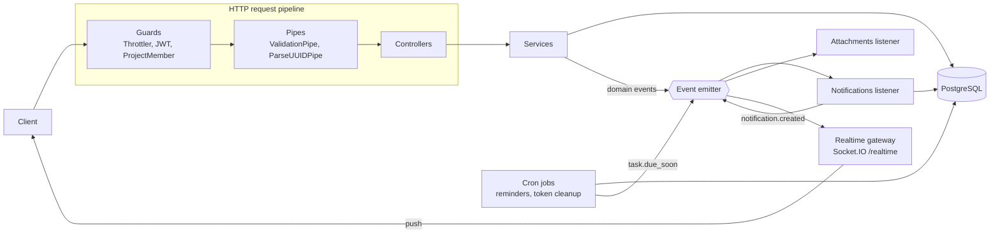

# Task Manager API

[](https://github.com/khoadauvang/nestjs-task-manager/actions/workflows/ci.yml)


A backend for team task management: projects with roles, tasks, comments, file attachments and real-time notifications. Built with **NestJS 12, TypeORM 1.x, PostgreSQL and Socket.IO**.

I built it as a learning project to practise NestJS end to end, so every feature was chosen to exercise a specific part of the framework (see [NestJS concepts](#nestjs-concepts-and-where-to-find-them)).

## Highlights

- **Authentication** with short-lived JWT access tokens and rotating refresh tokens. A reused refresh token revokes the whole login.
- **Per-project authorization** (owner / admin / member). Non-members get `404`, so they cannot even tell a project exists.
- **Tasks** with filtering, case-insensitive search, sorting and pagination.
- **Real-time updates** over Socket.IO: JWT-authenticated handshake, project rooms and personal notification rooms.
- **Event-driven design**: services emit domain events; notifications, WebSocket pushes and file cleanup react to them.
- **Safe file uploads**: type checked from the file content (magic numbers), size-limited, stored under server-generated names.
- **Scheduled jobs**: due-soon reminders that are sent exactly once, even with several app instances, and refresh-token cleanup.
- **Tested against a real database**: 37 unit tests and 34 end-to-end tests (HTTP and WebSocket) run in GitHub Actions with PostgreSQL.

## Tech stack

| Area | Tools |
|---|---|
| Framework | NestJS 12 (ESM), TypeScript 6 in strict mode |
| Database | PostgreSQL 17, TypeORM 1.x with migrations |
| Auth | `@nestjs/jwt`, bcrypt, `@nestjs/throttler`, helmet |
| Real time and background work | Socket.IO, `@nestjs/event-emitter`, `@nestjs/schedule` |
| Validation and docs | class-validator, class-transformer, zod (environment), Swagger / OpenAPI |
| Testing and tooling | Vitest, Supertest, socket.io-client, oxlint, Prettier, Docker, GitHub Actions |

## Architecture



Responses go back through two global interceptors: `ClassSerializerInterceptor` removes fields marked `@Exclude()` (password hashes, storage paths), and `TransformResponseInterceptor` wraps every body as `{ data }`, or `{ data, meta }` for paginated lists. Errors always have the same shape:

```json
{
  "statusCode": 404,
  "error": "Not Found",
  "message": "Project not found",
  "path": "/api/projects/0b9c1f2e-6f4a-4c1d-9a3e-2f8b7c6d5e4f",
  "timestamp": "2026-11-01T05:00:00.000Z"
}
```

## NestJS concepts and where to find them

| Concept | Where |
|---|---|
| Modules, dependency injection, exported providers | `src/modules/*/*.module.ts` |
| Dynamic modules (`forRoot`, `forRootAsync`, `registerAsync`) | `src/app.module.ts`, `src/modules/auth/auth.module.ts` |
| Validated configuration (zod) that fails fast at startup | `src/config/env.schema.ts` |
| Global guard with a `@Public()` opt-out | `src/modules/auth/guards/jwt-auth.guard.ts` |
| Resource-based guard reading metadata through `Reflector` | `src/modules/projects/guards/project-member.guard.ts` |
| Custom decorators (`@CurrentUser()`, `@CurrentMember()`, `@ProjectRoles()`) | `src/common/decorators/`, `src/modules/projects/decorators/` |
| Pipes: `ValidationPipe`, `ParseUUIDPipe`, `ParseFilePipe` | `src/app.module.ts`, controllers |
| DTOs and mapped types (`PartialType`, `PickType`) | `dto/` folders |
| Interceptors (serialization, response envelope) | `src/common/interceptors/` |
| Exception filter that maps PostgreSQL errors (unique violation → 409) | `src/common/filters/all-exceptions.filter.ts` |
| TypeORM entities, relations, enums, migrations | `entities/` folders, `src/database/` |
| Transactions | `ProjectsService.create` |
| Query builder with dynamic filters and safe sorting | `TasksService.findAll` |
| Domain events and listeners | `*.events.ts`, `*.listener.ts` |
| WebSocket gateway, rooms, handshake auth, `WsException` | `src/modules/realtime/` |
| Custom Socket.IO adapter (CORS from config) | `src/modules/realtime/socket-io.adapter.ts` |
| Task scheduling with `@Cron` | `task-reminders.job.ts`, `token-cleanup.job.ts` |
| File upload and streaming download (`FileInterceptor`, `StreamableFile`) | `src/modules/attachments/` |
| Rate limiting | `src/app.module.ts`, `src/modules/auth/auth.controller.ts` |
| OpenAPI docs generated by the Swagger CLI plugin | `nest-cli.json`, `src/app.setup.ts` |
| Unit tests with `Test.createTestingModule` and mocks | `src/**/*.spec.ts` |
| End-to-end tests (HTTP and WebSocket) | `test/` |

## Getting started

You need **Node.js 22.12 or newer** and **Docker**.

```bash
git clone https://github.com/khoadauvang/nestjs-task-manager.git
cd nestjs-task-manager
cp .env.example .env        # Windows (cmd): copy .env.example .env
```

**Option A: run everything in Docker**

```bash
docker compose up --build
```

**Option B: run the API locally, PostgreSQL in Docker**

```bash
docker compose up -d db
npm install
npm run start:dev
```

Then open:

- API: http://localhost:3000/api
- Interactive docs (Swagger): http://localhost:3000/docs
- Health check: http://localhost:3000/api/health

Migrations run automatically on startup (`DB_RUN_MIGRATIONS=true`). To try the API in Swagger, call `POST /api/auth/register`, copy `accessToken`, and paste it into **Authorize**.

### Environment variables

| Variable | Default | Description |
|---|---|---|
| `PORT` | `3000` | HTTP port |
| `CORS_ORIGINS` | `http://localhost:3000` | Comma-separated origins allowed for HTTP and WebSocket |
| `DB_HOST`, `DB_PORT`, `DB_USER`, `DB_PASSWORD`, `DB_NAME` | | PostgreSQL connection |
| `DB_RUN_MIGRATIONS` | `false` | Apply pending migrations on startup |
| `DB_LOGGING` | `false` | Log SQL queries |
| `JWT_ACCESS_SECRET` | | Required, at least 32 characters |
| `JWT_ACCESS_TTL_SECONDS` | `900` | Access token lifetime |
| `REFRESH_TOKEN_TTL_DAYS` | `7` | Refresh token lifetime |
| `BCRYPT_ROUNDS` | `12` | Password hashing cost |
| `UPLOAD_DIR` | `uploads` | Where attachments are stored |
| `SWAGGER_ENABLED` | `true` | Serve the docs at `/docs` |

## API overview

All routes are under `/api` and need `Authorization: Bearer <accessToken>` unless marked public.

| Method and path | Who |
|---|---|
| `POST /auth/register`, `POST /auth/login` | Public, limited to 5 requests per minute |
| `POST /auth/refresh`, `POST /auth/logout` | Public (needs a refresh token) |
| `POST /auth/logout-all` | Signed in |
| `GET /users/me`, `PATCH /users/me` | Signed in |
| `POST /projects`, `GET /projects` | Signed in |
| `GET /projects/:projectId` | Member |
| `PATCH /projects/:projectId` | Owner or admin |
| `DELETE /projects/:projectId` | Owner |
| `GET /projects/:projectId/members` | Member |
| `POST /projects/:projectId/members` | Owner or admin |
| `PATCH /projects/:projectId/members/:userId` | Owner |
| `DELETE /projects/:projectId/members/:userId` | Owner or admin, or yourself to leave |
| `GET`, `POST /projects/:projectId/tasks` | Member |
| `GET`, `PATCH /projects/:projectId/tasks/:taskId` | Member |
| `DELETE /projects/:projectId/tasks/:taskId` | Task creator, owner or admin |
| `GET`, `POST .../tasks/:taskId/comments` | Member |
| `DELETE .../tasks/:taskId/comments/:commentId` | Author, owner or admin |
| `GET`, `POST .../tasks/:taskId/attachments` | Member |
| `GET .../attachments/:attachmentId/download` | Member |
| `DELETE .../attachments/:attachmentId` | Uploader, owner or admin |
| `GET /notifications`, `GET /notifications/unread-count` | Signed in |
| `PATCH /notifications/:id/read`, `PATCH /notifications/read-all` | Signed in |
| `GET /health` | Public |

Task lists accept `page`, `limit`, `status`, `priority`, `assigneeId`, `search`, `sortBy` (`createdAt`, `dueDate`, `priority`, `title`) and `order` (`asc`, `desc`).

## Real-time events

Connect to the `/realtime` namespace with an access token:

```js
import { io } from 'socket.io-client';

const socket = io('http://localhost:3000/realtime', {
  auth: { token: accessToken },
});

socket.on('connect_error', (error) => console.error(error.message)); // "Unauthorized"

// Receive the project's task and comment events
await socket.emitWithAck('project:join', { projectId });

socket.on('task:updated', ({ task, actorId, changes }) => {
  /* update the board */
});
socket.on('notification:new', (notification) => {
  /* show a toast */
});
```

| Event (server → client) | Sent to |
|---|---|
| `task:created`, `task:updated`, `task:deleted` | Project room |
| `comment:created`, `comment:deleted` | Project room |
| `project:deleted` | Project room |
| `notification:new` | The recipient only |

A member removed from a project is taken out of its room right away. Errors in `project:join` arrive as an `exception` event.

## Testing

```bash
npm test             # unit tests
npm run test:e2e     # end-to-end tests, needs PostgreSQL (docker compose up -d db)
npm run test:cov     # unit tests with coverage
npm run lint && npm run typecheck
```

The end-to-end tests run against a separate `taskmanager_test` database, which is wiped and rebuilt from the migrations on every run. The configuration only allows that when `NODE_ENV=test` and the database name ends with `_test`, so the development database cannot be dropped by accident. Docker creates the test database the first time the volume is created; if your volume is older, create it once with `docker compose exec db createdb -U taskmanager taskmanager_test`.

## Database migrations

The schema only changes through migrations (`synchronize` is off).

```bash
# after changing an entity
npm run migration:generate -- src/database/migrations/AddTaskLabels
# then add the new class to src/database/migrations/index.ts
npm run migration:run
npm run migration:revert
```

## Project structure

```
src/
├── main.ts, app.module.ts, app.setup.ts
├── config/            environment validation (zod)
├── common/            decorators, filter, interceptor, pagination, utils
├── database/          TypeORM options, naming strategy, migrations, CLI data source
└── modules/
    ├── auth/          register, login, tokens, global JWT guard, cleanup job
    ├── users/
    ├── projects/      projects, members, roles, ProjectMemberGuard
    ├── tasks/         tasks, filters, reminder job
    ├── comments/
    ├── attachments/   uploads, storage, cleanup listener
    ├── notifications/ notifications created from domain events
    ├── realtime/      Socket.IO gateway and adapter
    └── health/
test/                  end-to-end tests
```

## Design decisions

- **Refresh-token rotation with reuse detection.** Refresh tokens are random strings stored as SHA-256 hashes. Each one works once; a conditional `UPDATE ... WHERE revoked_at IS NULL` makes sure two parallel requests cannot both use it. If a used token shows up again, every token of that login is revoked.
- **404 instead of 403 for outsiders.** Someone who is not in a project cannot tell whether it exists. Members without the right role get 403.
- **No cross-project access.** Every task, comment and attachment query includes the project id from the URL, so a valid task id cannot be reached through another project.
- **Events keep modules independent.** `TasksService` does not know that notifications, WebSockets or file cleanup exist; it only emits `task.*` events.
- **Global enhancers and WebSockets.** Global guards, pipes and interceptors also run for WebSocket messages (global exception filters do not), so they check `context.getType()`. Sockets are authenticated once in a handshake middleware, because guards do not run on connection.
- **Reminders sent exactly once.** The reminder job claims tasks with a single `UPDATE ... RETURNING`, so several app instances cannot send the same reminder.
- **Uploads are checked by content.** The file type comes from magic numbers, not from the name or the client's `Content-Type`; names on disk are generated by the server; downloads are forced with `Content-Disposition: attachment` and `X-Content-Type-Options: nosniff`.
- **Search and sorting are injection-safe.** `%` and `_` are escaped in `ILIKE` searches, and the sort column comes from a whitelist.

## Limitations and next steps

- Running several instances would need the Socket.IO Redis adapter so events reach every client.
- Attachments are stored on local disk; `AttachmentStorage` is the single place to switch to S3.
- Notifications are created by in-process listeners. A queue (BullMQ or RabbitMQ) would keep them if the process crashes.
- Project ownership cannot be transferred yet.

## How this project was built

I wrote the feature list and chose the NestJS concepts it should cover, then built it with Claude Code as an AI pair programmer. I use the codebase to study each concept in depth: reading the code, running the tests and extending them.

## License

[MIT](LICENSE)
